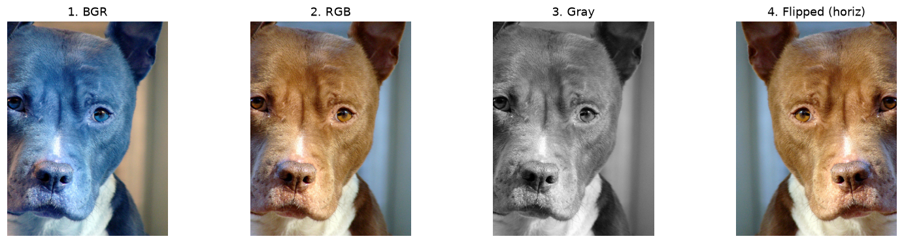
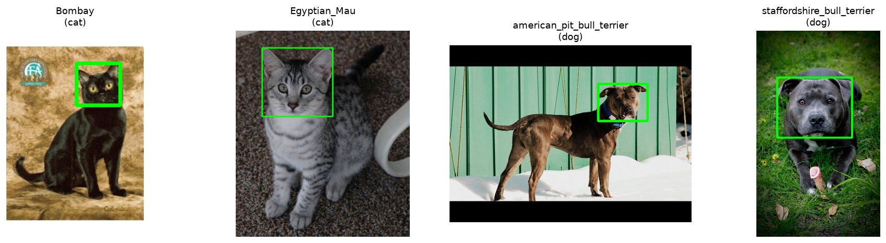

# Лабораторная 1: Среда, данные и первая сводка

**Вариант:** 12

## 1. Задача

Познакомиться с представлением изображений как массивов NumPy, базовыми операциями OpenCV (цветовые каналы BGR/RGB, оттенки серого, ресайз, отражение) и собрать первичную статистику по датасету Oxford-IIIT Pet для своего варианта.

## 2. Как запустить

Работа выполнялась локально в ОС Linux (Ubuntu) в виртуальном окружении Python 3.11/3.12:

```bash
# Активация окружения и установка зависимостей
source .venv/bin/activate
pip install -r requirements.txt

# Запуск ноутбука
jupyter lab lab01/solution.ipynb
# В открывшемся ноутбуке выполнить Kernel -> Restart Kernel and Run All Cells
```

Данные варианта скачиваются автоматически первой рабочей ячейкой ноутбука через скрипт `get_data.py`.

## 3. Данные

- **Вариант:** 12 (`data/variant_12/`)
- **Всего изображений:** 786
- **Породы (4 штуки):**
  - Кошки (`cat`): `Bombay` (200 шт.), `Egyptian_Mau` (195 шт.) — всего 395 кошек
  - Собаки (`dog`): `american_pit_bull_terrier` (200 шт.), `staffordshire_bull_terrier` (191 шт.) — всего 391 собака

## 4. Результаты

Сводные метрики датасета из `results/summary.csv`:

| Метрика | Значение |
| --- | --: |
| Номер варианта (`variant`) | 12 |
| Всего файлов (`n_files`) | 786 |
| Число пород (`n_breeds`) | 4 |
| Число кошек / собак (`n_cats` / `n_dogs`) | 395 / 391 |
| Ширина min / медиана / max (`min_width`, `median_width`, `max_width`) | 114 / 400.0 / 3264 |
| Высота min / медиана / max (`min_height`, `median_height`, `max_height`) | 103 / 352.0 / 2606 |
| Файлов с цветовым режимом не RGB (`n_non_rgb`) | 5 |
| Файлов с форматом не JPEG (`n_fake_jpg`) | 3 |
| Изображений с XML-разметкой головы (`n_with_xml`) | 392 |

### Примеры преобразований изображения


### Сетка пород с боксами голов (Pascal VOC XML)


## 5. Выводы

1. **Цветовые пространства BGR и RGB:** OpenCV по умолчанию считывает изображения в формате BGR. Для выбранного тестового изображения пиксель в центре кадра равен `[11, 46, 75]` в BGR, что при прямой передаче в Matplotlib интерпретируется как красно-коричневый вместо синего, а само животное приобретает неестественный синий оттенок. Явная конвертация `cv2.cvtColor(bgr, cv2.COLOR_BGR2RGB)` восстанавливает правильный порядок каналов.
2. **Аномалии формата и цветовых каналов:** В датасете 5 файлов из 786 имеют цветовой режим, отличный от `RGB` (3 файла в оттенках серого `L` — например, `Egyptian_Mau_129.jpg`, и 2 файла с альфа-каналом `RGBA` — `Egyptian_Mau_14.jpg` и `Egyptian_Mau_186.jpg`). Кроме того, 3 файла с расширением `.jpg` на самом деле являются форматом `PNG`. `cv2.imread(p)` по умолчанию скрывает это, отдавая 3 канала, однако `cv2.imread(p, cv2.IMREAD_UNCHANGED)` для ч/б файла возвращает форму `(348, 500)` без третьей размерности каналов. В последующих задачах классификации и детекции такие файлы сломают сборку тензоров в батчи, если их явно не приводить через `convert("RGB")`.
3. **Разброс разрешений и деформация при ресайзе:** Линейные размеры изображений варианта варьируются более чем в 28 раз по ширине (от 114 до 3264 пикселей, медиана 400) и в 25 раз по высоте (от 103 до 2606 пикселей, медиана 352). Принудительное сжатие `cv2.resize(rgb, (224, 224))` деформирует пропорции нестандартных кадров (сплющивает или вытягивает животных). Для качественного обучения потребуется сохранение соотношения сторон с паддингом (letterbox).
4. **Покрытие разметкой боксов головы:** Боксы в формате Pascal VOC присутствуют ровно у 392 изображений из 786 (~49.87%), распределяясь практически поровну (по 100 у Bombay, Pit Bull и Bull Terrier, и 92 у Egyptian Mau). Это означает, что для обучения детектора голов доступна только половина датасета.
