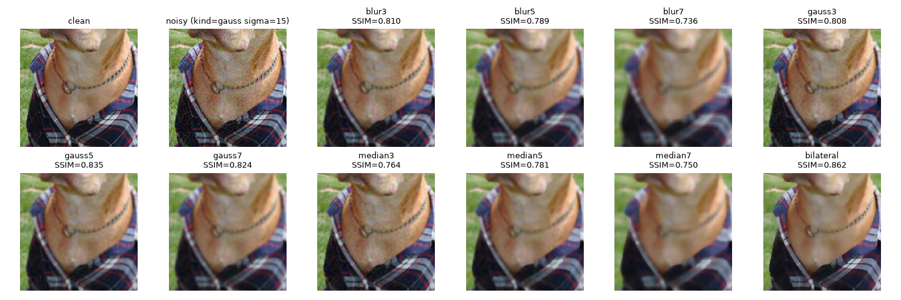
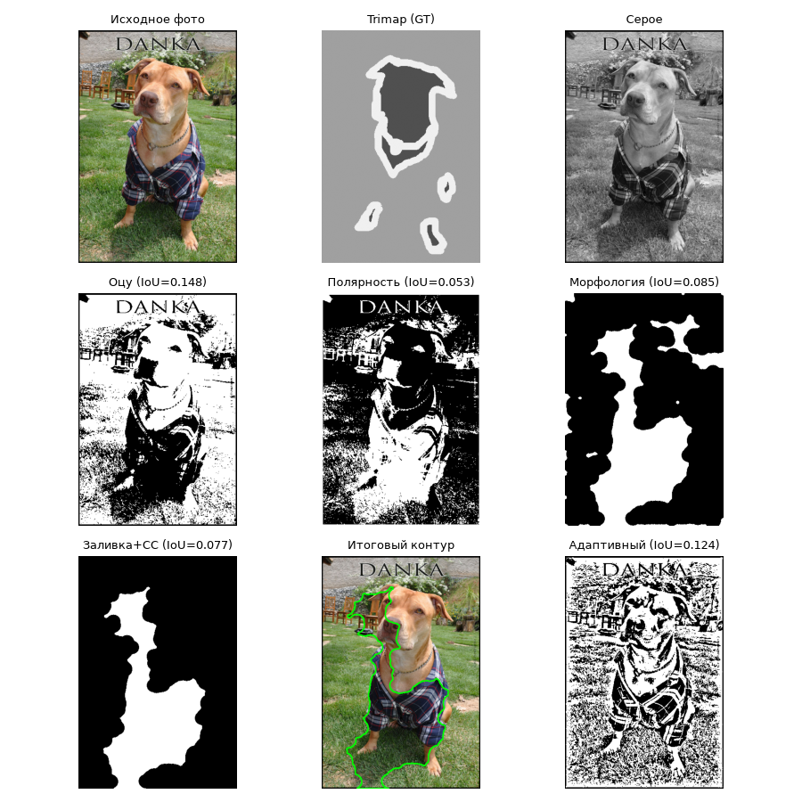
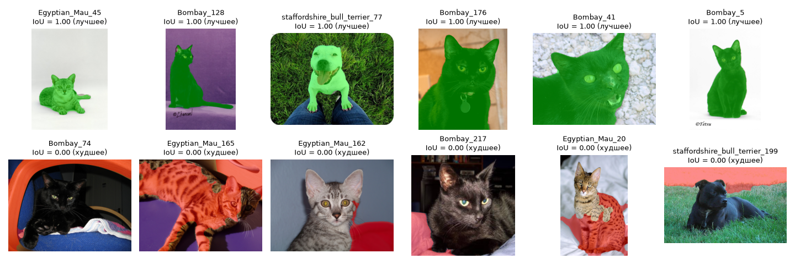
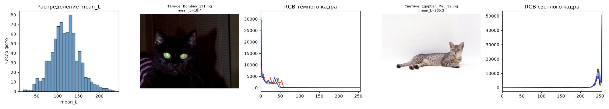
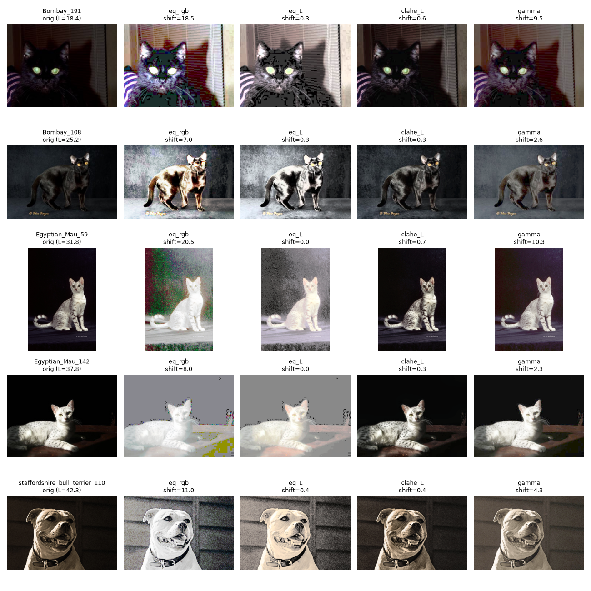

# Лабораторная 2: Классическая обработка изображений

**Вариант:** 12

## 1. Задача

Исследовать характеристики изображений (освещённость, шум, резкость), изучить алгоритмы улучшения контраста и фильтрации гауссова шума, а также построить классический пайплайн сегментации животного (бинаризация Оцу, исправление полярности, морфология, связные компоненты) с оценкой качества по trimap-маскам через метрику IoU и извлечением признаков геометрической формы.

## 2. Как запустить

Работа выполнялась локально в ОС Linux (Ubuntu) в виртуальном окружении Python 3.11/3.12:

```bash
# Активация окружения и установка зависимостей
source .venv/bin/activate
pip install -r requirements.txt

# Запуск ноутбука
jupyter lab lab02/solution.ipynb
# В открывшемся ноутбуке выполнить Kernel -> Restart Kernel and Run All Cells
```

Ноутбук воспроизводимо отрабатывает все ячейки сверху вниз за ~1.5 минуты на CPU без использования GPU.

## 3. Данные

- **Вариант:** 12 (`data/variant_12/`)
- **Всего изображений:** 786 (395 кошек, 391 собака)
- **Породы (4 штуки):**
  - Кошки: `Bombay` (200 шт.), `Egyptian_Mau` (195 шт.)
  - Собаки: `american_pit_bull_terrier` (200 шт.), `staffordshire_bull_terrier` (191 шт.)
- **Шум варианта:** Гауссов шум с $\sigma = 15$ (`kind: "gauss", sigma: 15`).

## 4. Результаты

### Сводные метрики лабораторной работы

| Метрика / Параметр | Значение |
|---|--:|
| План шума варианта 12 | Гауссов шум ($\sigma = 15$) |
| Исходное качество зашумлённого кадра (`none`) | PSNR = 24.99 дБ, SSIM = 0.5179 |
| Лучший фильтр (`BEST_FILTER`) | `bilateral` (билатеральный) |
| Качество лучшего фильтра (`bilateral`) | **PSNR = 31.95 дБ, SSIM = 0.8622** (время = 2.60 мс/кадр) |
| Второй результат по фильтрации (`gauss5`) | PSNR = 30.60 дБ, SSIM = 0.8348 (время = 0.14 мс/кадр) |
| Выбранный канал сегментации (`CHANNEL`) | `gray` (градации серого) |
| IoU базовой сегментации («только Оцу») | mean IoU = **0.191** (median = 0.099) |
| IoU после добавления фильтра | mean IoU = **0.192** (median = 0.095) |
| IoU после исправления полярности | mean IoU = **0.444** (median = 0.414) |
| IoU после морфологии (`open=7, close=31`) | mean IoU = **0.477** (median = 0.456) |
| Итоговый IoU пайплайна («+ заливка и компонента») | mean IoU = **0.498** (median = **0.489**) |

---

### Иллюстрации результатов

#### 1. Сравнение фильтров шумоподавления (кропы $160 \times 160$)


#### 2. Пошаговый пайплайн сегментации


#### 3. Лучшие и худшие маски по метрике IoU


#### 4. Распределение яркости и гистограммы RGB


#### 5. Коррекция освещённости тёмных кадров


---

## 5. Выводы

### Часть 1. Освещённость, шум и фильтры
1. **Эффективность фильтров при гауссовом шуме:** Для шума с $\sigma = 15$ победителем стал билатеральный фильтр (`bilateral`), показавший PSNR = 31.95 дБ и SSIM = 0.8622, тогда как исходное зашумлённое изображение имело PSNR = 24.99 дБ и SSIM = 0.5179. Билатеральный фильтр превзошёл стандартный `gauss5` (+1.35 дБ по PSNR и +0.027 по SSIM), поскольку учитывает не только пространственную близость пикселей, но и разницу в интенсивностях, сглаживая шум без размытия контуров и текстуры шерсти. Медианные фильтры показали себя хуже (у `median3` SSIM = 0.7643), так как они оптимизированы под импульсный шум («соль и перец»), а не под непрерывное нормальное распределение.
2. **Вычислительная сложность:** Победитель `bilateral` требует около 2.60 мс на кадр, что в 18 раз медленнее, чем `gauss5` (0.14 мс) и `gauss3` (0.11 мс), однако для задач предобработки в пределах нескольких миллисекунд это полностью оправдано качеством сохранения мелких деталей.
3. **Искажение цветового баланса при поканальном выравнивании:** Поканальное выравнивание гистограммы по RGB (`eq_rgb`) привело к катастрофическому сдвигу цвета $\Delta E = 13.01$ (в цветовом пространстве Lab), окрашивая тёмные шерсть и фон в неестественные цвета из-за независимой растяжки диапазонов R, G и B. Напротив, выравнивание только канала яркости $L$ в пространстве Lab (`eq_L`) дало минимальный цветовой сдвиг $\Delta E = 0.19$, а адаптивный `clahe_L` — $\Delta E = 0.48$ при естественном сохранении локального контраста без пересветов.
4. **Разброс характеристик между породами:** Порода `Bombay` оказалась самой тёмной по средней яркости ($mean\_L = 106.83$ против среднего по датасету $118.11$) из-за черного окраса кошек. Порода `staffordshire_bull_terrier` имеет максимальную среднюю резкость ($sharpness = 1027.63$ против $222.74$ у `Bombay`), что связано с контрастной короткой шерстью и частым присутствием детализированного уличного фона.

### Часть 2. Сегментация и признаки формы
5. **Вклад этапов пайплайна в качество маски (Ablation study):**
   - Базовая бинаризация Оцу на сером канале дала средний IoU всего **0.191** (медиана 0.099), так как на светлом фоне объект оказывается инвертирован (чёрным объектом на белом фоне).
   - Шаг исправления полярности по краям кадра дал наибольший скачок качества: прирост составил **+0.253** к mean IoU (рост до **0.444**).
   - Морфологические операции (открытие ядром $7 \times 7$ и закрытие $31 \times 31$) устранили шум и объединили разорванные части силуэта, добавив ещё **+0.033** (рост до **0.477**).
   - Заливка внутренних полостей и выделение наибольшей связной компоненты подняли итоговый mean IoU до **0.498** (медиана **0.489**), суммарно увеличив качество относительно «чистого Оцу» более чем в 2.6 раза.
6. **Анализ худших масок и геометрических различий:**
   - Худшие результаты (IoU близкий к 0) наблюдаются в случаях, когда цвет животного практически совпадает с фоном (например, чёрная бомбейская кошка на тёмном диване или светлый питбуль на фоне выжженной травы) — на таких кадрах глобальный порог Оцу отсекает либо всё изображение, либо оставляет изолированные фрагменты.
   - По геометрическим признакам маски кошек оказались более вытянутыми ($elongation = 1.498$ против $1.451$ у собак) и обладающими меньшей компактностью / округлостью ($circularity = 0.313$ у кошек против $0.288$ у собак), что объясняется выраженными силуэтами ушей и хвоста.
