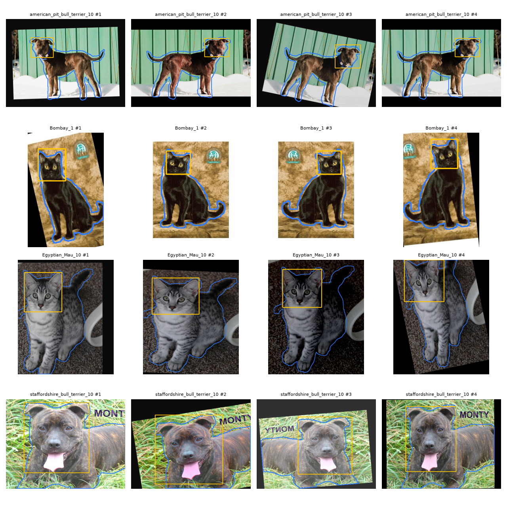
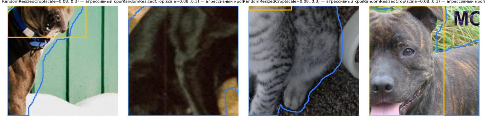

# Лабораторная 3. Данные: разметка, дубликаты, разбиение, аугментации

## Задача

Провести аудит датасета Oxford-IIIT Pet для варианта 12: проверить качество разметки,
перевести аннотации в форматы COCO и YOLO, найти дублирующиеся изображения,
построить честное групповое разбиение train/val/test и собрать пайплайн аугментаций.

## Как запустить

```bash
# Убедитесь, что данные лежат в data/variant_12/
# (скачиваются автоматически при запуске ноутбука)

cd cv-2026-kucher
source .venv/bin/activate   # или .venv\Scripts\activate на Windows

# Запустить весь ноутбук:
jupyter nbconvert --to notebook --execute --inplace lab03/solution.ipynb
# Либо открыть в Jupyter и нажать Restart & Run All
```

## Данные

**Вариант:** 12  
**Породы:**

| ID | Порода | Вид |
|----|--------|-----|
| 0 | Bombay | кошка |
| 1 | Egyptian_Mau | кошка |
| 2 | american_pit_bull_terrier | собака |
| 3 | staffordshire_bull_terrier | собака |

**Всего:** 786 изображений, 392 XML-разметки голов, 786 trimap-масок.

## Результаты

### Таблица split_summary.csv

| Метрика | Значение |
|---------|---------|
| Вариант | 12 |
| SEED | 2026 |
| Групп из 2+ фото | 26 |
| Фото в группах | 54 |
| Среднее разорванных групп (случайное разбиение) | 12.47 |
| Среднее групп train∩test (случайное) | 5.72 |
| Разорванных групп (групповое разбиение) | **0** |
| train: фото / с рамкой / с маской | 561 / 275 / 554 |
| val: фото / с рамкой / с маской | 112 / 55 / 112 |
| test: фото / с рамкой / с маской | 113 / 62 / 113 |
| Мин. доля породы по сплитам | 0.239 |
| Макс. доля породы по сплитам | 0.259 |

### Сетка аугментаций



### Аугментация, которая ломает разметку



## Выводы

1. **Качество разметки в целом хорошее**: из 786 фото замечания имеют 10 (1.3%). Основные проблемы:
   3 файла Egyptian_Mau хранятся как PNG с расширением `.jpg`, 5 изображений имеют нестандартный режим (3 × L, 2 × RGBA), 1 фото имеет пустой trimap.

2. **Преобразование форматов точное**: обратный перевод VOC → YOLO → VOC даёт максимальное расхождение **0.001 пикселя**; IoU маска→полигон→маска: медиана **0.9951**, минимум **0.9361**.

3. **21 побайтовая копия и 26 групп связанных фото** (54 фото суммарно). Случайное разбиение разрывало бы в среднем **12.5 из 26** групп и давало бы **5.7 групп** одновременно в train и test, что является прямой утечкой данных. Групповое разбиение (`StratifiedGroupKFold`, n_splits=7): **0 разорванных групп**, **0 утечек**.

4. **Доли пород сбалансированы**: min=0.239, max=0.259 — разница в пределах 2 п.п., стратификация работает корректно. Разбиение 561/112/113 ≈ 71/14/14%.

5. **Площадь рамки головы**: медиана **0.145** площади кадра, 10.2% рамок занимают менее 5% кадра, минимальная сторона — **34 пикселя**. Это важно при выборе минимального размера объекта для детектора.

6. **Агрессивный кроп ломает разметку**: `RandomResizedCrop(scale=0.08..0.3)` полностью убирает голову из кадра в **25.4%** случаев и оставляет менее половины головы в **76.2%** случаев — такую аугментацию нельзя использовать без обрезки рамок по границе кадра.
