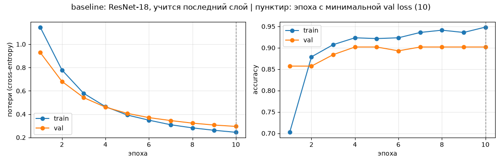
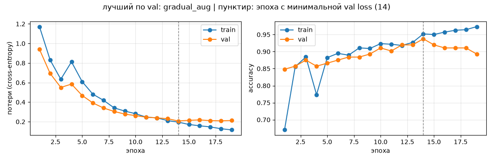
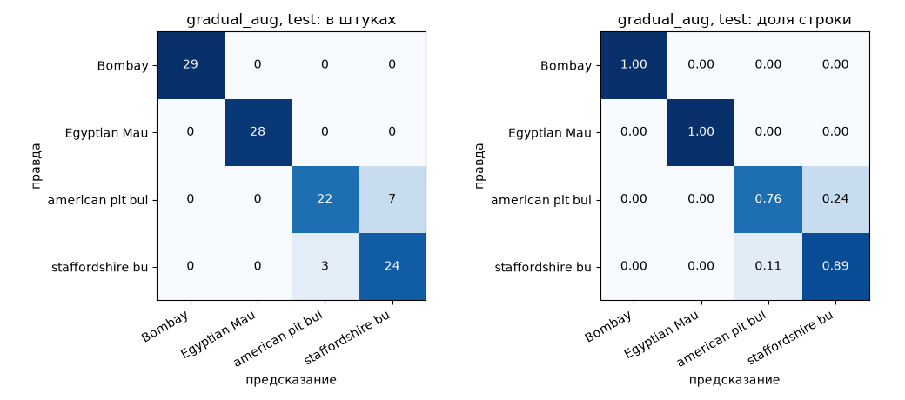
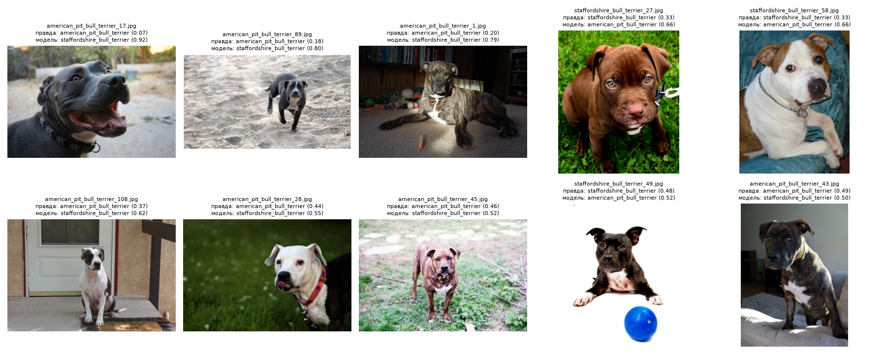

# Лабораторная 4. Классификация пород: перенос обучения и метрики

## Задача

Дообучить предобученную на ImageNet нейросеть ResNet-18 для классификации четырёх пород животных варианта 12, используя разбиение `split.csv` из лабораторной работы 3. Построить baseline с обучением только последнего слоя, сравнить три варианта улучшения на валидационной выборке и оценить итоговое качество лучшей модели на тестовой выборке с детальным анализом ошибок.

## Как запустить

```bash
# Убедитесь, что виртуальное окружение активно и установлены зависимости:
cd cv-2026-kucher
source .venv/bin/activate

# Запуск всего пайплайна через nbconvert:
cd lab04
jupyter nbconvert --to notebook --execute --inplace solution.ipynb
# Либо открыть solution.ipynb в Jupyter Notebook и нажать Restart & Run All
```

## Данные

- **Вариант:** 12
- **Породы:**
  - 0: `Bombay` (кошка)
  - 1: `Egyptian_Mau` (кошка)
  - 2: `american_pit_bull_terrier` (собака)
  - 3: `staffordshire_bull_terrier` (собака)
- **Разбиение:**
  - `train`: 561 фото (сбалансировано по ~140 на породу)
  - `val`: 112 фото (по 28 на породу)
  - `test`: 113 фото (29 Bombay, 28 Egyptian Mau, 29 pit bull, 27 staffordshire)

## Результаты

### Эксперименты на валидации (`experiments.csv`)

| Модель | Режим | lr | Аугментации | unfreeze_at | Эпох обучено | Лучшая эпоха | val loss | val accuracy | val macro-F1 | Время (с) |
|---|---|---|:---:|:---:|:---:|:---:|:---:|:---:|:---:|:---:|
| `baseline` | head | 0.001 | ❌ | — | 10 | 10 | 0.2949 | 0.9018 | 0.9018 | 8.6 |
| `head_aug` | head | 0.001 | ✅ | — | 20 | 20 | 0.2432 | 0.9018 | 0.9018 | 19.6 |
| `all_1e-4_aug` | all | 0.0001 | ✅ | — | 20 | 20 | 0.2142 | 0.9286 | 0.9275 | 28.3 |
| `gradual_aug` | gradual | 0.001 | ✅ | 4 | 19 | **14** | **0.2071** | **0.9375** | **0.9373** | 25.3 |

Лучшей моделью по валидационным потерям признана `gradual_aug` (val loss 0.2071, val accuracy 93.75%).

### Итоговые метрики на тесте (`test_metrics.csv`)

| Порода / Метрика | Baseline Precision | Baseline Recall | Baseline F1 | Gradual+Aug Precision | Gradual+Aug Recall | Gradual+Aug F1 | Support |
|---|:---:|:---:|:---:|:---:|:---:|:---:|:---:|
| `Bombay` | 1.0000 | 1.0000 | 1.0000 | 1.0000 | 1.0000 | 1.0000 | 29 |
| `Egyptian_Mau` | 1.0000 | 1.0000 | 1.0000 | 1.0000 | 1.0000 | 1.0000 | 28 |
| `american_pit_bull_terrier` | 0.8750 | 0.7241 | 0.7925 | 0.8800 | 0.7586 | 0.8148 | 29 |
| `staffordshire_bull_terrier` | 0.7500 | 0.8889 | 0.8136 | 0.7742 | 0.8889 | 0.8276 | 27 |
| **macro** | **0.9062** | **0.9033** | **0.9015** | **0.9135** | **0.9119** | **0.9106** | 113 |
| **accuracy** | — | — | **0.9027** | — | — | **0.9115** | 113 |

### Кривые обучения baseline



### Кривые обучения лучшей модели (`gradual_aug`)



### Матрица ошибок лучшей модели



### 10 худших примеров на тесте



## Выводы

1. **Качество baseline на фоне случайного угадывания**: точность baseline на val составила **90.18%** (на test — **90.27%**), что кардинально превосходит уровень случайного угадывания (25.0% для четырёх сбалансированных классов) и подтверждает высокую информативность предобученных признаков ResNet-18 для Oxford-IIIT Pet.
2. **Параметры и скорость обучения**: в baseline обучалось лишь **2 052** параметра классификатора из **11 178 564** общего числа (доля **0.018%**), а среднее время эпохи на GPU NVIDIA GeForce RTX 4070 составило всего **0.8 с** (8.6 с на весь цикл из 10 эпох).
3. **Динамика сходимости baseline**: потери на val стабильно снижались вплоть до 10-й эпохи (0.2949), при этом train loss опустился до 0.244, а train accuracy составила 94.83% против 90.18% на val. Разрыв между train и val невелик (~4.6 п.п.), признаков критического переобучения не наблюдалось, однако модель не исчерпала потенциал оптимизации.
4. **Сравнение экспериментов**: наибольший прирост качества на валидации дала схема постепенной разморозки с аугментациями (`gradual_aug`), снизив val loss с 0.2949 до **0.2071** и повысив val accuracy с 90.18% до **93.75%** (+3.57 п.п.). Схема разморозки всей сети с 4-й эпохи с уменьшением lr в 10 раз (`lr=1e-4`) позволила адаптировать высокоуровневые сверточные фильтры к специфике пород без разрушения предобученных весов.
5. **Тестовые результаты и анализ ошибок**: на тестовой выборке лучшая модель показала accuracy **91.15%** и macro-F1 **0.9106** (против 90.27% и 0.9015 у baseline). Разница между val (93.75%) и test (91.15%) составляет 2.6 п.п., что полностью укладывается в статистическую погрешность теста (±5% для выборки из 113 фото).
6. **Трудная пара варианта**: все **10 ошибок** лучшей модели на test (100% неверных предсказаний) пришлись строго на классификацию между `american_pit_bull_terrier` и `staffordshire_bull_terrier` (7 питбулей классифицированы как стаффорды и 3 стаффорда — как питбули). Кошек (`Bombay` и `Egyptian_Mau`) модель классифицирует безошибочно с идеальным F1-score **1.0000**; собаки и кошки не перепутаны ни разу.

### Разбор десяти худших примеров

Все 10 худших примеров на тестовой выборке принадлежат трудной паре пород собак (`american_pit_bull_terrier` и `staffordshire_bull_terrier`), у которых чрезвычайно близкий экстерьер и общие предки. Анализ причин ошибок по категориям:
- **Похожие породы (5 примеров)**: `american_pit_bull_terrier_17.jpg`, `american_pit_bull_terrier_89.jpg`, `american_pit_bull_terrier_45.jpg`, `american_pit_bull_terrier_43.jpg` (уверенность 50/50), `american_pit_bull_terrier_163.jpg`. У собак наблюдается классический массивный череп, короткая шерсть и купированные/полустоячие уши, делающие однозначную дифференциацию питбуля и стаффорда субъективной даже для эксперта-кинолога.
- **Нетипичный вид (2 примера)**: `staffordshire_bull_terrier_58.jpg` (вертикальный снимок и поза животного визуально удлиняют морду, маскируя компактность стаффорда), `staffordshire_bull_terrier_49.jpg` (сильно пересвеченный фон и ракурс полубоком скрадывают пропорции ширины грудной клетки).
- **Сцена (2 примера)**: `american_pit_bull_terrier_108.jpg` (животное находится на заднем плане, голова занимает менее 70 пикселей кадра, детали мимики и прикуса отсутствуют), `american_pit_bull_terrier_28.jpg` (собака в густой траве и тени, скрывающей форму корпуса).
- **Качество (2 примера)**: `american_pit_bull_terrier_1.jpg` и `staffordshire_bull_terrier_27.jpg` (сильное затемнение снимка и потеря контраста в области морды).

*Вывод из анализа ошибок*: для дальнейшего повышения точности на трудной паре требуется не общая аугментация кадра, а локализация головы (что будет реализовано в лабе 5 по детекции) и обучение на кропах высокого разрешения с акцентом на форму черепа и пропорции морды.
