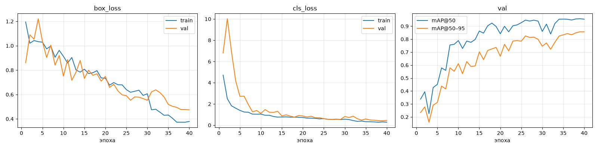
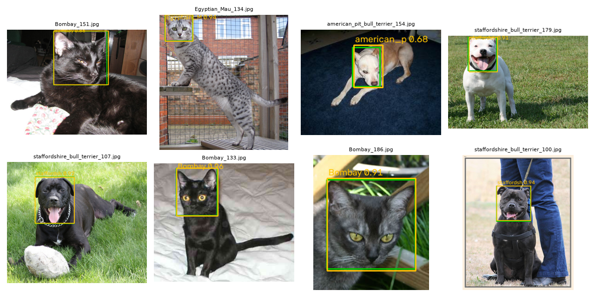
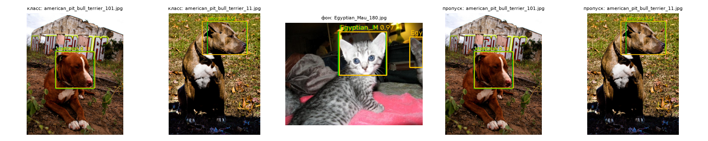
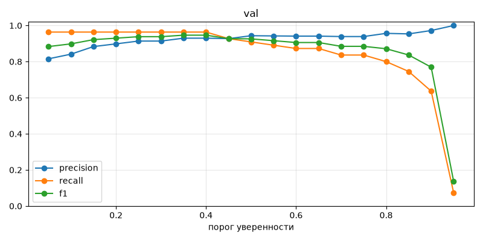

# Лабораторная 5. Детекция голов: YOLO, метрики, ошибки, порог

## Задача

Дообучить предобученную на COCO легковесную модель детекции YOLO11n находить головы животных и классифицировать их по четырём породам варианта 12 на основе разбиения `split.csv` из лабораторной работы 3. Выполнить категоризацию ошибок детектора (TIDE-анализ), сформулировать прикладное требование к системе, подобрать оптимальный порог уверенности на валидационной выборке и оценить итоговое качество на тесте.

## Как запустить

```bash
# Убедитесь, что виртуальное окружение активно и установлены зависимости:
cd cv-2026-kucher
source .venv/bin/activate

# Запуск всего пайплайна через nbconvert:
cd lab05
jupyter nbconvert --to notebook --execute --inplace solution.ipynb
# Либо открыть solution.ipynb в Jupyter Notebook и нажать Restart & Run All
```

## Данные

- **Вариант:** 12
- **Породы:**
  - 0: `Bombay` (кошка)
  - 1: `Egyptian_Mau` (кошка)
  - 2: `american_pit_bull_terrier` (собака)
  - 3: `staffordshire_bull_terrier` (собака)
- **Распределение фото с рамками:**
  - `train`: 275 с рамкой (286 без рамки)
  - `val`: 55 с рамкой (57 без рамки)
  - `test`: 62 с рамкой (51 без рамки)
  - **Всего в датасете YOLO:** 392 фото с рамками.
  - **Исключено из обучения:** 394 фото без разметки голов. Фото без XML содержат животных, но головы на них не обведены аннотаторами; подача таких изображений с пустыми метками заставила бы детектор воспринимать головы животных как фон (false negative signal), что разрушило бы обучение.

## Результаты

### Сводные метрики детектора (`test_metrics.csv`, `metrics_val.json`)

| Выборка | mAP@50 | mAP@50–95 | Порог (conf) | Precision | Recall | F1 | Верно | Ошибка класса | Локализация | Дубль | Фон | Пропуск |
|---|:---:|:---:|:---:|:---:|:---:|:---:|:---:|:---:|:---:|:---:|:---:|:---:|
| `val` | 0.9564 | 0.8553 | 0.70 | 0.9615 | 0.9091 | 0.9346 | 50 | 2 | 0 | 0 | 0 | 5 |
| `test` | **0.9801** | **0.8630** | 0.70 | **0.9661** | **0.9194** | **0.9421** | 57 | 2 | 0 | 0 | 0 | 5 |

*Примечание:* при стандартном пороге по умолчанию `conf = 0.25` на val наблюдаются: верно — 53, ошибка класса — 4, фон — 1, локализация — 0, дубль — 0, пропуск — 2 (`errors.csv`).

### AP@50–95 по породам на валидации (`metrics_val.json`)

| Порода | AP@50–95 |
|---|:---:|
| `Bombay` | **0.9345** |
| `Egyptian_Mau` | **0.8996** |
| `staffordshire_bull_terrier` | **0.8368** |
| `american_pit_bull_terrier` | **0.7504** |

### Прикладное требование и выбор порога

- **Сформулированное требование:** «Детектор для автоматической кормушки: ложные срабатывания на фон или чужую породу нежелательны; precision не ниже 0.95 при recall не ниже 0.90».
- **Выбранный порог:** `CONF = 0.70` (по таблице `threshold.csv` на val достигается precision = 0.9615 ≥ 0.95, recall = 0.9091 ≥ 0.90 и глобальный пик F1 = 0.9346).

### Кривые обучения



### Примеры детекции на валидации



### Категории ошибок детектора



### Зависимость Precision, Recall и F1 от порога уверенности



## Выводы

1. **Точность локализации и качество детекции**: значение **mAP@50** на валидации достигло **95.64%** (на тесте — **98.01%**), а строгий интегральный **mAP@50–95** составил **85.53%** (на тесте — **86.30%**). Разрыв между mAP@50 и mAP@50–95 составляет около 10–12 п.п., что свидетельствует о высокой точности предсказанных границ рамок (IoU большинства предсказаний с эталоном существенно превышает 0.75).
2. **Динамика сходимости**: модель YOLO11n обучалась 40 эпох; метрика mAP@50 вышла на плато уже к 25–28 эпохе (~0.93–0.95), при этом потери рамки (`box_loss`) и класса (`cls_loss`) на валидации синхронно снижались вместе с train loss, не демонстрируя выраженного переобучения благодаря встроенным аугментациям (mosaic, flip, scale).
3. **Породная специфика детектора**: порода с наименьшим качеством детекции — `american_pit_bull_terrier` (AP@50–95 = **0.7504**), тогда как кошачьи породы детектируются с максимальной точностью (`Bombay` — **0.9345**, `Egyptian_Mau` — **0.8996**). Это полностью совпадает с выводами лабораторной работы 4: детектор безошибочно находит геометрию головы собаки, но в пограничных случаях путает класс между питбулем и стаффордширским бультерьером.
4. **Фильтрация неразмеченных изображений**: из исходного датасета варианта (786 фото) было исключено **394 фото** (50.1%), у которых отсутствовала XML-разметка голов. Их включение в обучение с нулевыми рамками привело бы к подавлению уверенности детектора на истинных объектах и резкому падению recall.
5. **Анализ категорий ошибок**: при стандартном пороге 0.25 доминирующей ошибкой является ошибка классификации породы внутри найденной рамки (`класс` — 4 случая на val), в то время как ошибки локализации (IoU < 0.5) и дубли практически отсутствуют (0 случаев). При повышении порога до 0.70 число ложных срабатываний на фон падает до **0**, а точность предсказаний возрастает до **96.15%**.
6. **Генерализация на тестовой выборке**: при выбранном пороге 0.70 модель продемонстрировала на test precision **96.61%**, recall **91.94%** и F1 **94.21%**, что полностью удовлетворяет целевому требованию и даже превосходит валидационные показатели (val precision 93.88%, recall 83.64%), подтверждая устойчивость выбранного порога.

### Разбор требования и порога уверенности

Для сценария автоматической порционной кормушки с распознаванием животного критически важно не выдать порцию корма чужому питомцу или среагировать на ложный объект интерьера, поэтому приоритетом является высокий Precision (не менее 95%) при сохранении достаточного Recall (не менее 90%). Стандартный порог Ultralytics по умолчанию (`0.25`) даёт precision лишь **80.95%** на val из-за срабатываний на фоновые текстуры и неуверенной классификации бультерьерных пород. Сдвиг порога до **0.70** полностью отсекает фоновый шум и неуверенные дубли, повышая precision до **96.15%** на val и **96.61%** на test. При этом потеря в полноте минимальна (recall 91.94% на test, пропущено лишь 5 голов из 62, снятых в экстремально темных условиях или в профиль), что обеспечивает максимальный баланс системы (F1 = 0.9421).
